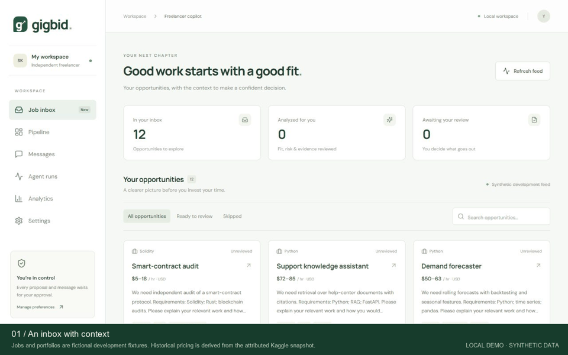
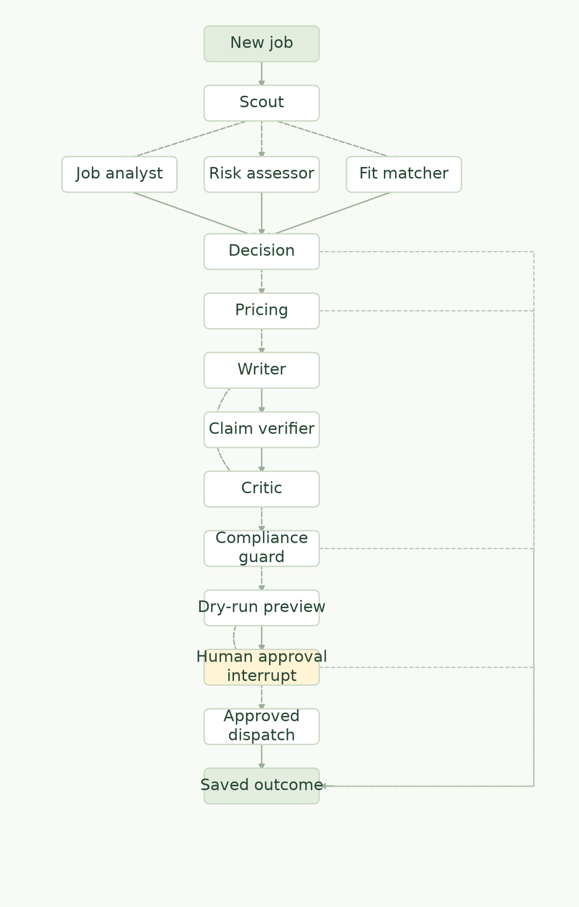

# GigBid



**Find a suitable job. Show the work that proves your fit. Approve every send.**

GigBid is a React/TypeScript and FastAPI freelancer copilot with a handwritten LangGraph workflow, portfolio evidence retrieval, authenticated MCP tools and durable human approvals. It runs on local open models without a paid API.

**Current access:** local app at <http://127.0.0.1:8000>. Public deployment is not yet configured. Private local reviewer credentials are in `runtime/reviewer-login.txt`, excluded from Git. See [completion status](docs/STATUS.md) before treating this as a final submission.



## Run locally on this Windows machine

From `C:\Users\PC\Desktop\agentic_A3\gigbid`:

```powershell
..\.venv\Scripts\python.exe -m scripts.start_local
```

The prepared `.env` uses the workspace's Ollama service at port 11436 and model files under `D:\ollama\models`. The API, Portfolio MCP, Marketplace MCP, Workspace MCP and durable worker start together. Stop them with Ctrl+C. The local URL is already served during development; do not start a second copy on the same ports.

For a fresh machine, install Python 3.12 and Node 22, create a virtual environment, install PyTorch appropriate to your CPU/CUDA, then `pip install '.[dev]'`. Copy `.env.example` to `.env`, set a random secret and encryption key, run `python -m scripts.seed_data`, `npm ci --prefix apps/web`, build the frontend and start the services. [Detailed runbook](docs/RUNBOOK.md).

```sh
docker compose --env-file .env -f infra/docker-compose.yml up --build
```

Compose is supplied for Postgres, Redis, Qdrant, Ollama, Phoenix, web/API, worker, MCP services and an explicitly labelled local simulator fixture. A working Docker daemon is required. Container startup has not been validated on this machine because the Docker engine is unavailable.

## What is implemented

- Parallel analyst, risk and fit branches; pricing, evidence-constrained writing, verification, bounded critique and policy checks.
- LangGraph proposal/message interrupts, edit/reject/approve, persisted checkpoints and exact-content approval grants.
- SDK Portfolio, Marketplace and Workspace MCP servers, schemas, resources/prompts, auth, rate limiting, dry runs, audit and idempotent local writes.
- V0 dense, V1 requirement decomposition, V2 BM25/dense RRF, V3 cross-encoder, V4 outcome ranking and V8 corrective retrieval.
- Multi-user onboarding, job inbox/detail, proposal studio, pipeline, messages, agent runs, analytics, settings, upload and deletable memory.
- Real historical pricing from the attributed Kaggle snapshot; fictional portfolios/jobs/outcomes remain labelled synthetic.
- Open-model, tool-design, retrieval, decisions, safety and architecture experiment runners, plus X1 agency routing.

Live adapters and SDK OAuth plumbing fail closed until official schemas, mappings and account authorization are supplied. They are not represented as verified live integrations.

## Measured results

Final local validation: **28 Python tests and six browser flows passed**, with successful frontend build, lint, dependency-lock and Compose syntax checks. Container startup and live account integrations remain unverified. [Validation details](docs/FINAL_VALIDATION.md) · [Published deliverables](docs/PUBLIC_LINKS.md).

| Retriever | Recall@5 | nDCG@10 | p95 seconds |
|---|---:|---:|---:|
| V0 dense | 0.9595 | 0.9714 | 0.0156 |
| V1 decomposition (selected) | 0.9794 | 0.9913 | 0.0052 |
| V2 hybrid RRF | 0.9794 | 0.9863 | 0.0041 |
| V3 cross-encoder | 0.9653 | 0.9759 | 0.0379 |
| V4 outcome ranking | 0.9794 | 0.9863 | 0.0050 |
| V8 corrective graph | 0.9653 | 0.9759 | 0.0490 |

These 600-job measurements use synthetic relevance labels and cached queries. They do not establish real-world retrieval quality. The later 30-job routed-model smoke reached approval on 27 eligible jobs and skipped three. A separate synthetic client study improved replies, but did not improve hires; see the validation details.

The current tables are generated into [RESULTS.md](docs/RESULTS.md) from [evals/results](evals/results). Raw records, hardware, sample sizes and limitations are included there. Run `python -m scripts.build_results_tables` after new experiments.

V1 is the provisional shipped retriever selected by synthetic dev nDCG@10. High synthetic decision scores reflect rule/template overlap and do not predict performance on the missing official or hidden sets. Paid API spend is zero; hardware/electricity costs are excluded.

## Reproduce and inspect

```sh
make seed
make test
make eval
make lint
python -m evals.runners.model_eval --limit 30
python -m evals.runners.tool_eval
python -m evals.runners.architecture_eval --limit 50
cd apps/web && npm run test:e2e
```

Browser report: `apps/web/playwright-report/index.html`. Open `/runs` to inspect saved node events and tenant-scoped tool audit. Public Phoenix trace links require a deployed tracing service; none are fabricated here.

[Pipeline](docs/PIPELINE.md) · [Requirements](docs/REQUIREMENTS.md) · [Architecture](docs/ARCHITECTURE.md) · [Data and licenses](docs/DATA_CARD.md) · [Tools](docs/TOOLS.md) · [AI usage](docs/AI_USAGE.md) · [Viva guide](docs/VIVA.md).

This code is MIT licensed. Third-party data/models retain their own licenses. The assignment's original deadline precedes this work; no commit history or timestamps are backdated.
