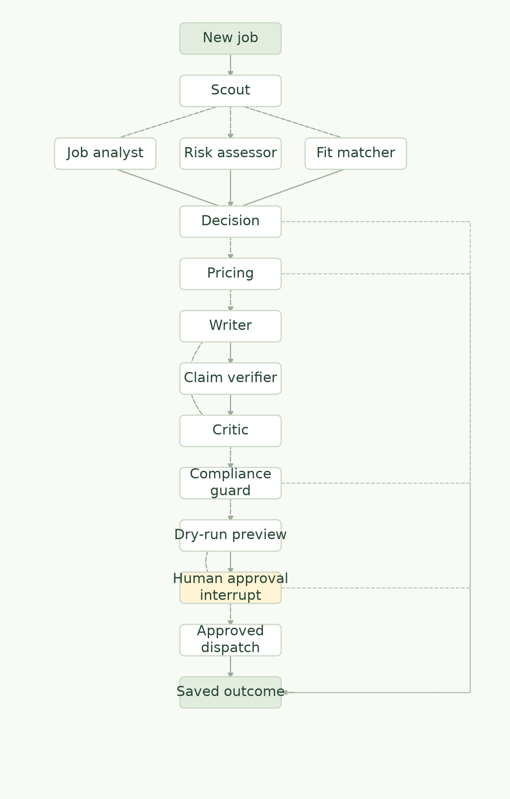
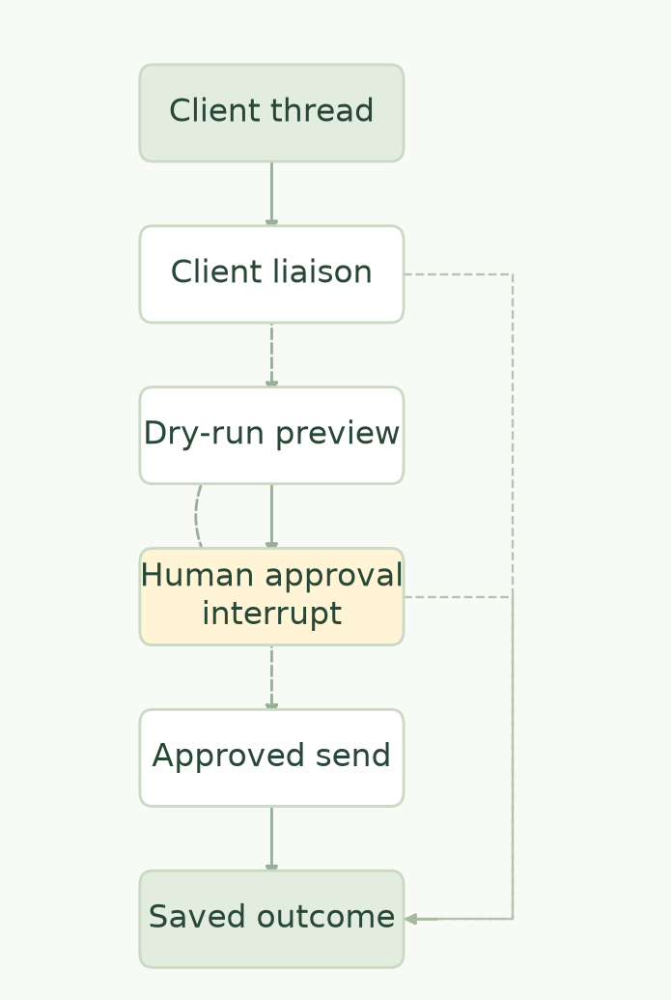

# Architecture and state discipline

React uses the generated FastAPI OpenAPI types. API requests authenticate a tenant, persist/enqueue work, and return promptly. The local launcher runs a separate durable-queue worker; Compose uses Arq/Redis. The worker executes a handwritten StateGraph with checkpointing. Durable SSE snapshots/events let refreshes resume observation without losing approval state.

The Scout reads a job through Marketplace MCP. LangGraph `Send` fans out Analyst, Risk and Fit, with additive reducers for events, tokens and step count. Analyst structures the known fields and uses an open model for uncertainties. Risk applies an auditable rule baseline to job text/client history. Fit retrieves portfolio evidence. A join makes the bid/skip decision. Pricing respects the user's floor, client ceiling, real historical hourly medians and Connects constraints. Writer uses a model for a plan while inserting experience only as exact approved facts or verbatim quotations. The verifier removes unverified assertions before the Critic. Critic revisions are bounded; unresolved problems become visible needs-attention states. Compliance may block. Preview precedes an interrupt; every edit is checked and requires a fresh approval. Dispatch re-reads evidence and carries an exact-payload authorization grant to the marketplace boundary.

The conversation graph reads a tenant's client thread, classifies question/negotiation/interview/scam intent, suggests a conservative response and mock UTC interview slots, previews and interrupts. Edits return to preview. Sending requires the same server-validated authorization discipline. Calendar/email tools are a local mock as the assignment permits; no actual email is delivered.

**State** is a per-thread TypedDict containing job/spec/risk/fit/decision/price/draft/critique/compliance/approval/outcome. **Trace** is the append-only masked tool/event audit plus optional Phoenix OTLP spans. **Memory** consists of two durable LangGraph BaseStore namespaces, style and outcome, populated only through promotion rules. Repeated user deletions require distinct edit events; outcomes require minimum observations and positive rate. UI deletion removes promoted memory. Raw tool outputs are never promoted automatically.

All agent capabilities use `ToolGateway` and per-role allowlists. Servers own database/file/marketplace access. Application infrastructure loads config/prompts and supplies user preferences/memory; agent nodes do not open client files or call marketplace REST endpoints directly. The Marketplace port selects the local mock, configurable instructor REST adapter or official Upwork MCP adapter. Missing official schemas fail closed. OAuth uses SDK discovery/PKCE and encrypted tenant storage; actual account connection remains unverified.

SQLite supports the tested local application and checkpoint recovery. Postgres supports the same document repository and native Postgres checkpointer in Compose. Redis backs Arq scheduling. Local cosine matrices/BM25 are the measured vector index; a configured Qdrant URL stores chunks and executes dense queries with tenant/persona filters. The embedded-engine test checks that identical evidence IDs in different tenants remain isolated. The reported retrieval timings use the local cosine index; networked Qdrant performance is unmeasured. Phoenix is configured in Compose; public trace publishing requires deployment.

Tradeoffs: deterministic risk/fit rules are cheap and interpretable but depend on explicit skill coverage and pattern detection. Conservative extractive verification sacrifices paraphrase fluency and can discard harmless plans. Local synthetic outcome labels cannot train real success predictions. These limits are part of the measured system, not hidden behind agent names.
